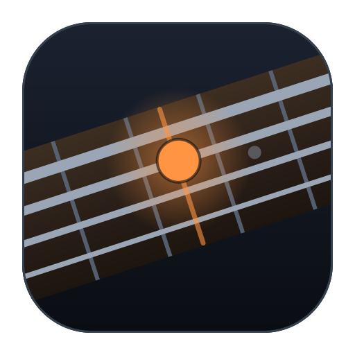
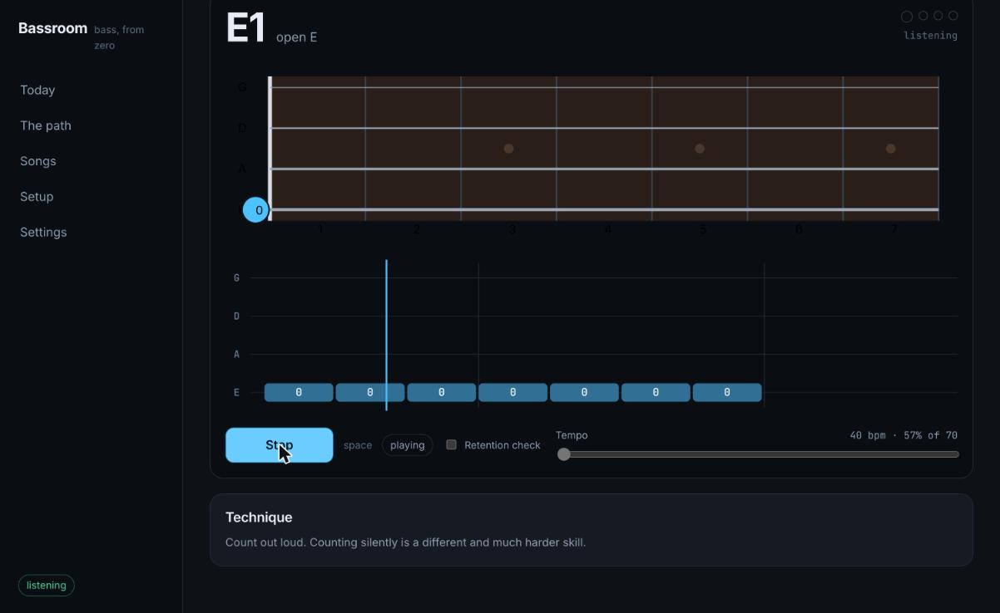
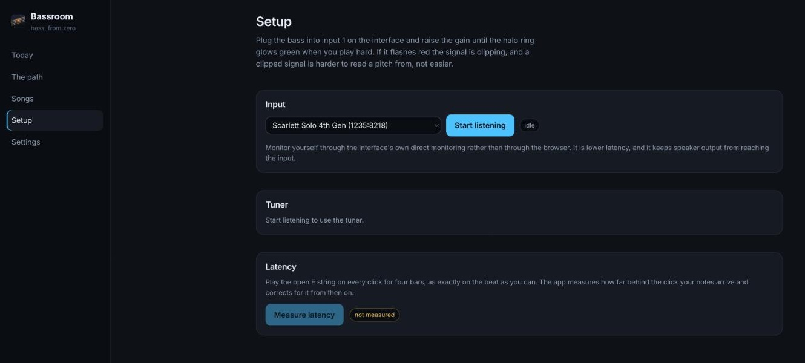
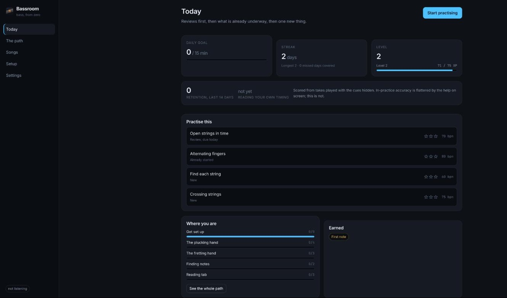
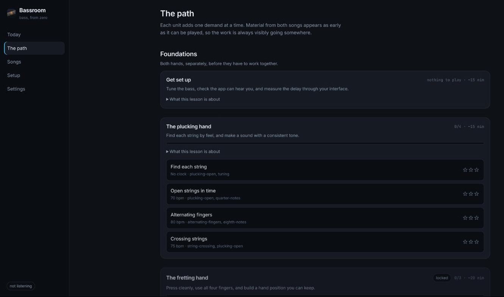
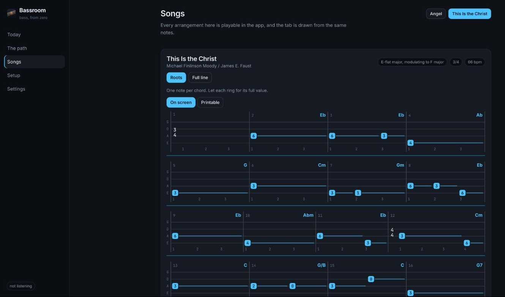
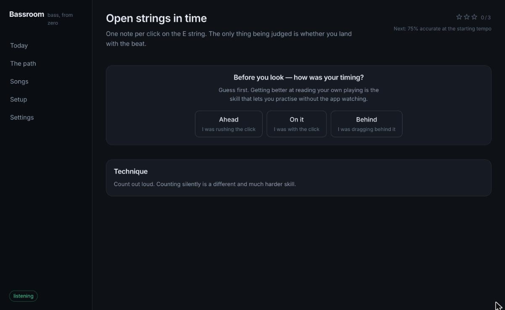

<div align="center">



# Bassroom

**A practice coach that teaches bass guitar from zero.**

It listens to you play through an audio interface, tells you what you actually did rather than what you think you did, and works through a path that ends at two specific songs: **Angel** by Massive Attack, and the hymn **This Is the Christ**.

[](https://github.com/voidnologo/bassroom/actions/workflows/ci.yml)

</div>



Both songs are in `tabs/`, transcribed and cross-checked. Both are playable inside the app at any tempo from a crawl upward.

## Running it

You need Node 20 or newer, a bass, and an audio interface. A Focusrite Scarlett Solo is what this was built against.

```bash
./start
```

That installs dependencies on the first run, builds the worklet, starts the Vite dev server and the coach server together, and opens the app once it answers. Ctrl-C stops everything. Run it a second time and it opens the tab on the server already running rather than starting another one.

For something to click, or to find in Spotlight:

```bash
./scripts/make-launcher.sh
```

That builds `~/Applications/Bassroom.app`, a bundle whose only job is to open a terminal on `./start` — so there stays one definition of how the app starts, and the dev server's output stays somewhere you can read it. Set `BASSROOM_TERMINAL_APP` to iTerm or Ghostty before running it to use a different terminal.

The npm commands work too, if you would rather drive it yourself:

```bash
cd app
npm install
npm run dev
```

Either way, open http://localhost:5173, go to **Setup**, start the input, and run the latency measurement. That measurement is what makes the timing feedback honest, so it is worth the two minutes.



The coach works offline out of the box. To use a model for feedback instead of the built-in rules, copy `app/.env.example` to `app/.env` and put an Anthropic API key in it. The key is read by the local coach server and never reaches the browser.

Firefox and Safari will mostly work, but Chrome is the one with reliable `AudioWorklet` timing and device selection. On Linux, the interface needs to be visible to PipeWire or PulseAudio before the browser will offer it.

## What it does

**Listens properly.** Pitch detection is YIN over a 128 ms window at a decimated 12 kHz, written here rather than taken from a library, because most JavaScript pitch libraries have a hard floor above the bottom octave of a bass. Onsets are detected separately and instantly, so timing judgments do not wait for a pitch window to fill. The whole chain is covered by tests that run against synthesised bass tones and check every open string to within 10 cents.

**Shows you the neck.** The note you are meant to play, which string and fret, which finger, and what the app is actually hearing — on a fretboard drawn the way you are looking at it.

**Grades pitch and timing separately.** Playing the right note late is a different mistake from playing the wrong note on time, and the app says which one you made, in cents and milliseconds.

**Drives the tempo ladder for you.** Two clean takes and the tempo goes up; one poor take and it comes down. This is the single mechanic most responsible for a passage becoming playable at speed, and the one people skip when left to their own judgment.

**Measures what you retain, not what you can do with help.** Accuracy while the scrolling highway and the fretboard marker are both helping is inflated by exactly that help. A **retention check** plays the same music with every cue hidden, and that is the score the dashboard reports as progress.

**Asks before it tells.** After a take you are asked whether you were ahead, behind or on it, before you see the answer. Reading your own playing is the skill that lets you practise when nothing is watching.

**Keeps you coming back.** XP, levels, badges, and a streak that bends before it breaks: two missed days are covered automatically and earned back weekly, because a streak that one bad week destroys mostly produces guilt and then abandonment.

## A look at it

|                                                                                                                                                                                                                                    |                                                                                                                                                                                                                         |
| ---------------------------------------------------------------------------------------------------------------------------------------------------------------------------------------------------------------------------------- | ----------------------------------------------------------------------------------------------------------------------------------------------------------------------------------------------------------------------- |
| <br>**Today** — reviews first, then what is already underway, then new material. | <br>**The path** — each lesson opens once the one it needs is passed.                     |
| <br>**Songs** — the tab is generated from the notes the app plays.               | <br>**Asked before told** — you guess, then you see the numbers. |

## The path

Ten lessons in four units, from "which string is which" to the complete hymn. Material from both target songs appears as early as it can be played, so the work is always visibly going somewhere.

| Unit          | Lessons                                                           |
| ------------- | ----------------------------------------------------------------- |
| Foundations   | Get set up · The plucking hand · The fretting hand                |
| Fundamentals  | Finding notes · Playing in time · Shapes that move                |
| Playing music | Ode to Joy, Twinkle, Happy Birthday                               |
| The songs     | Angel · This Is the Christ, roots · This Is the Christ, full line |

See [docs/curriculum.md](docs/curriculum.md) for what each lesson is for and why it is where it is.

## The songs

**[This Is the Christ](tabs/this-is-the-christ.md)** — the notes come from the publisher's own MusicXML rather than from ear, so the pitches, the chord symbols, the 3/4-to-4/4 change at bar 12 and the key change into the chorus are all exact. Two arrangements: chord roots, and the hymn's own bass line moved into the bass guitar's register.

**[Angel](tabs/angel.md)** — the entire six-minute part is two notes, C and the D above it, which makes it an unusually good first song: there is almost no fingering to learn and all the difficulty is rhythm. Four arrangements, each adding one thing.

The tab files are generated from the same data the app plays, by `npm run tabs`, and CI fails if they drift apart.

## Layout

```
start         starts everything; the launcher and the docs both point at it
scripts/      the macOS launcher bundle and the icon it is built from
app/          the application
  src/audio/    stream, worklet, and the DSP behind it
  src/music/    pitch arithmetic, fretboard geometry, tab rendering
  src/content/  exercises, songs, the curriculum
  src/engine/   judging, scoring, the tempo ladder
  src/progress/ mastery, review scheduling, gamification
  src/coach/    feedback providers behind one interface
  src/ui/       screens and components
  server/       the coach proxy and the practice log
docs/         how it works and why
tabs/         generated tab, for reading away from the screen
.claude/      rules and tooling for working on this with an agent
```

## Working on it

```bash
npm run verify        # format, lint, types, tests, tab freshness
npm test              # vitest
node ../.claude/skills/quality-check/scripts/gates.mjs --all
```

The project rules live in [`.claude/rules/`](.claude/rules), each with an ID, a one-clause reason and an enforcement venue; [`CLAUDE.md`](CLAUDE.md) routes from the area being changed to the rules that govern it. The complexity budgets are deliberately strict and are not to be raised to make code pass.

## On the music

The hymn is © 1995, 2024 IRI, and Angel is © Massive Attack and its publishers. The transcriptions here are for personal study. No recordings are bundled, no published tablature is reproduced, and nothing here is a substitute for buying the music.
